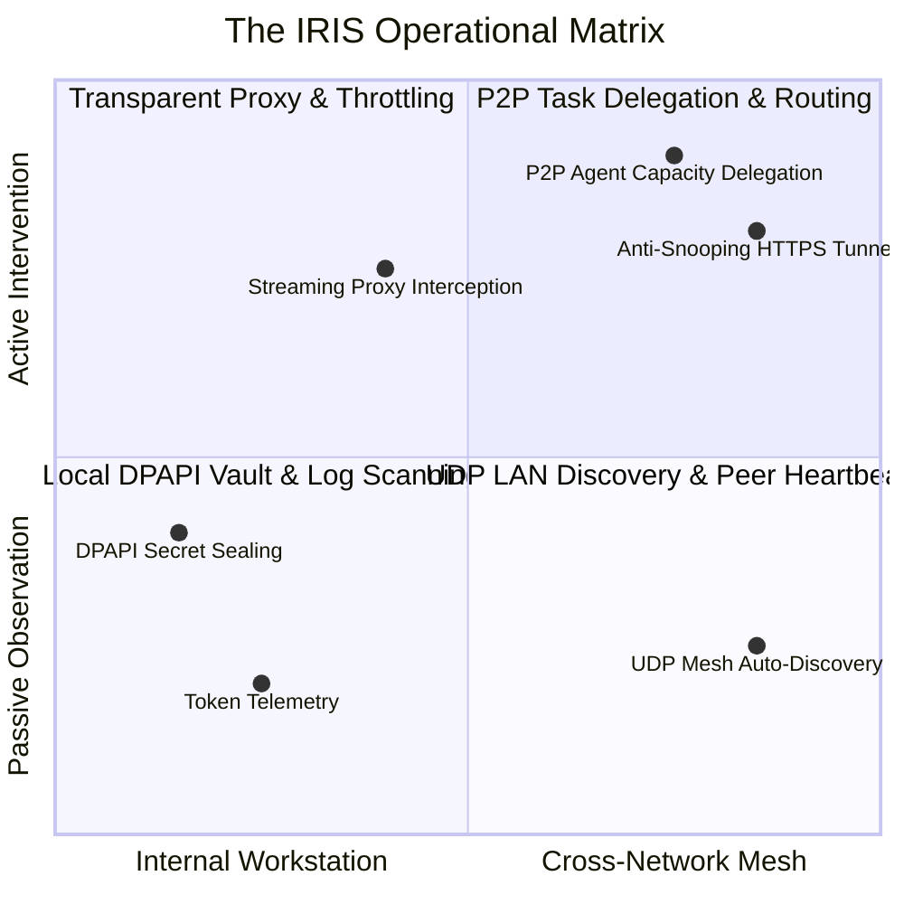

# IRIS: Inter-node Routing, Inference & Security

## Platform Identity, Mythological Heritage & Architectural Justification

```
  ██╗██████╗ ██╗███████╗
  ██║██╔══██╗██║██╔════╝
  ██║██████╔╝██║███████╗
  ██║██╔══██╗██║╚════██║
  ██║██║  ██║██║███████║
  ╚═╝╚═╝  ╚═╝╚═╝╚══════╝
  Inter-node Routing, Inference & Security
```

---

## 1. The Greek Mythology of Iris (Ἶρις)

In the classical Greek pantheon, **Iris** (Ἶρις) was the golden-winged goddess of the rainbow and the personal, trusted messenger of Zeus and Hera. While Hermes served as the general herald across mortal markets and boundaries, Iris was the sovereign emissary called upon for missions of supreme sensitivity and paramount trust.

### The Sacred Conduit Across Realms
Iris was unique among the immortals for her ability to move seamlessly and untamed between three distinct realms:
1. **Mount Olympus** (the celestial realm of the gods),
2. **The Mortal Earth** (the domain of human affairs), and
3. **Tartarus / The Underworld** (the deepest, most perilous abyss).

She traveled along the arc of the **rainbow**—not merely an aesthetic display, but an ethereal, divine highway connecting the heavens, the terrestrial soil, and the depths of the earth without ever being trapped, corrupted, or impeded by the chaotic winds between them.

### The Golden Ewer of the River Styx
In Hesiod’s *Theogony*, Iris held the solemn duty of descending to the underworld to fetch water from the sacred River Styx in an unyielding golden pitcher (*ewer*). When disputes or solemn treaties arose among the gods, Zeus sent Iris to bring this water. The gods would pour a libation and swear their inviolable oaths upon it. Any oath sworn upon the water Iris delivered was absolute, eternal, and incorruptible; even the Olympian gods were bound to its law under threat of profound exile.

---

## 2. Architectural Relevance & How Our Platform Earns the Right to the Name

To adopt the name of a classical deity, an engineering system must prove that its core mechanics resonate authentically with the myth. IRIS does not merely use the name as an ornamental label; every architectural subsystem corresponds directly to the divine office of Iris:

### A. The Rainbow as the Multi-Model Spectrum
*   **The Myth**: Iris embodies the full radiant spectrum of visible light, bending all seven hues into a coherent, overarching arc that spans the horizon.
*   **The Platform Reality**: Modern enterprise AI development is fractured across fragmented, competing ecosystems. IRIS observes and assimilates this entire spectrum:
    - *The Cloud Frontier*: Anthropic Claude, Google Gemini, OpenAI ChatGPT, Microsoft 365 Copilot.
    - *The Sovereign On-Premise Spectrum*: Local Ollama, LM Studio, vLLM, KoboldCPP, and custom fine-tunes.
    - Rather than forcing engineers into a single vendor's silo, IRIS unifies every wavelength into a single pane of glass, harmonizing token rates, quotas, and velocity curves without distortion.

### B. The Golden Ewer: Immutable Cryptographic Integrity
*   **The Myth**: Iris transported the sacred water of Styx in an impenetrable golden vessel, ensuring it remained untouched and unpolluted during transit across hazardous realms.
*   **The Platform Reality**: 
    - At rest, all API secrets, OAuth tokens, and cluster pairing credentials are sealed within **Windows Native DPAPI** (`CryptProtectData` via `crypt32.dll`), tied strictly to the Windows user logon. Plaintext secrets never touch disk or logs.
    - In transit, IRIS carries agent prompts, tool calls, and completions across the local network through **TLS 1.3 encrypted HTTPS tunnels** (`AES-256-GCM` / `ChaCha20-Poly1305`). Packet sniffers, network wiretaps, and eavesdroppers on the corporate LAN see only opaque cryptographic payloads. The payload arrives as pure and untampered as the waters in Iris's golden vessel.

### C. The Golden Wings: Zero-Dependency Swiftness
*   **The Myth**: Iris was celebrated for her golden wings (*Chrysopteros*), allowing her to move swifter than the west wind (*Zephyrus*, her consort), appearing instantly wherever summoned.
*   **The Platform Reality**: IRIS rejects the bloated dependency trees common in modern software. With **zero third-party pip dependencies** and **zero npm baggage**, IRIS relies exclusively on the standard library and native Windows APIs. It launches in milliseconds, consumes less than 30MB of RAM, and runs silently in the background with unnoticeable CPU overhead.

### D. The Sovereign Bridge: Local P2P Agent Mesh & Delegation
*   **The Myth**: Iris bridged isolated enclaves that otherwise could not communicate, establishing direct, sovereign channels between disparate authorities.
*   **The Platform Reality**: IRIS transforms isolated developer workstations into a cohesive, collaborative peer-to-peer compute grid. When one developer’s machine lacks the GPU VRAM to run a 70B parameter model, IRIS delegates the agent task over the secure tunnel to an idle workstation across the room. Capacity is pooled, sovereignty is preserved, and data never leaves the local perimeter.

---

## 3. The Definitive Acronym: I.R.I.S.

To reflect both its engineering discipline and its functional mandate, the platform is officially designated:

### **I.R.I.S.**
### **I**nter-node **R**outing, **I**nference & **S**ecurity

```
   [ I ] -> INTER-NODE
            Automatic zero-configuration LAN discovery (UDP beacon) that detects
            peer instances, advertises compute capacity, and builds local mesh pools.

   [ R ] -> ROUTING
            Intelligent delegation of agent workloads, quota bursting, and transparent
            proxy forwarding to optimize cluster-wide hardware and API utilization.

   [ I ] -> INFERENCE
            Real-time multi-provider model monitoring, streaming token extraction (SSE),
            and universal OpenAI/Ollama-compatible local inference emulation.

   [ S ] -> SECURITY
            Windows DPAPI vault encryption, TLS 1.3 anti-snooping tunnels, mutual peer
            authentication, and proactive sanitization of diagnostic logs.
```

---

## 4. The Four Functional Mandates



1. **Observant (The Unblinking Eye)**:
   Continuously monitors all AI interactions across the workstation without introducing latency or requiring developers to alter their workflow.
2. **Centralizing / Assimilating (The Radiant Spectrum)**:
   Normalizes multi-provider telemetry into a unified taxonomy, reconciling token consumption, quota resets, and financial velocity across all accounts.
3. **Protecting (The Golden Ewer)**:
   Shields corporate assets, private source code, and developer API credentials from external exfiltration and internal LAN eavesdropping.
4. **Delegating (The Swift Envoy)**:
   Routes autonomous agent prompts and inference tasks dynamically to whichever local workstation possesses the available compute capacity.
