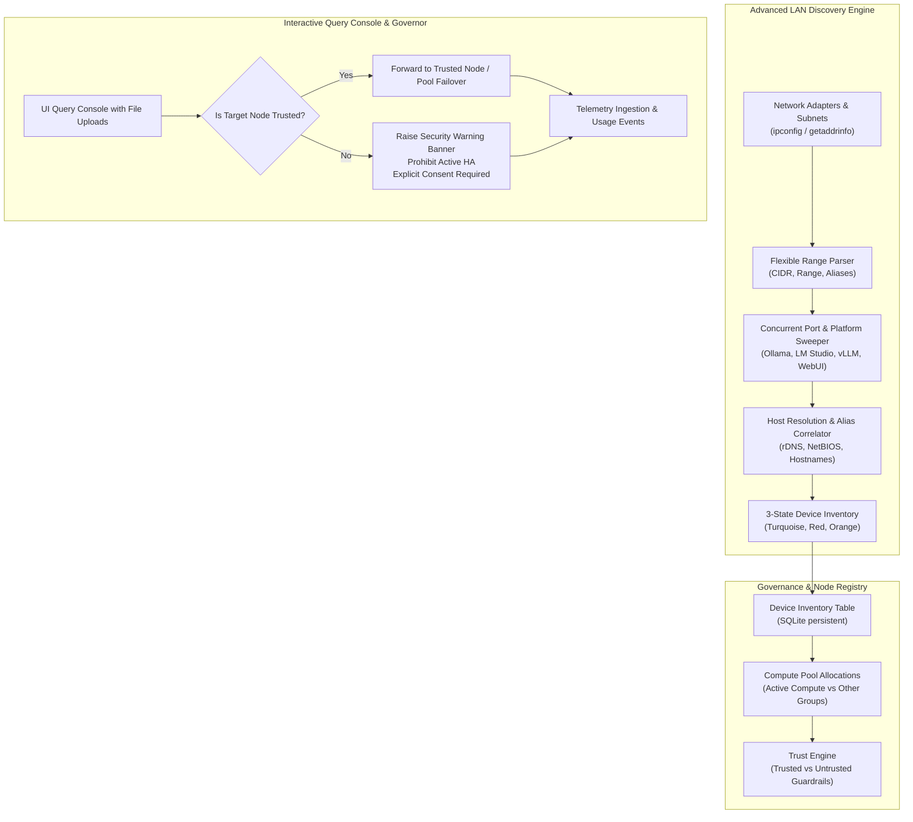

# Design Decision: Configurable LAN Discovery, Alias-Based Device Inventory, Trusted Compute Groups & Query Console

**Date**: 2026-10-16  
**Status**: Approved  
**Author**: Antigravity Pair Programming & Engineering Team  
**Ticket**: AIUM-704  
**Epic**: EPIC-DISTRIBUTED-TELEMETRY  

---

## 1. Context & Problem Statement
The initial LAN discovery scanner made two restrictive assumptions:
1. It relied on a single outbound UDP route to infer a `/24` subnet. On machines with multiple network adapters (e.g., Ethernet, WiFi, Tailscale, WSL, corporate subnets like `10.1.7.x`), it frequently scanned the wrong adapter or missed remote instances (such as ASUS ROG at `Jamese-PC / 10.1.7.74`).
2. Discovered hosts were identified solely by ephemeral IP addresses, without alias correlation (e.g. NetBIOS/DNS hostnames), port/platform customizability, device inventory state tracking, or trust classification.
3. When using distributed nodes, developers had no mechanism to mark resources as trusted vs untrusted, segregate them into active compute vs staging pools, or safely run interactive queries with file context without risking data leakage to untrusted nodes.

---

## 2. Architectural Design

### A. Advanced Multi-Adapter Discovery & Flexible Target Parser (`lan_scanner.py`)
- Detects all local IPv4 interface bindings and calculates proper subnet masks.
- Supports intuitive presets (`Auto-detected`, `Class C 192.168.1.0/24`, `Class C 192.168.0.0/24`, `Class A 10.1.7.0/24`, `Loopback 127.0.0.1`, `Custom IP Range / CIDRs / Aliases`).
- Evaluates ranges like `10.1.7.1-10.1.7.100` and comma-separated hostnames/aliases like `Jamese-PC, 10.1.7.74`.
- Enforces an automated safety clamp (default 1024 hosts) to prevent network flooding if wide masks like `/16` are entered.
- Automatically resolves reverse DNS and aliases (`socket.gethostbyaddr`) to store hostnames as primary durable references across DHCP IP reassignments.

### B. Platform Catalog & Secondary Port Scanning
- Checkbox-driven selection of platforms:
  - `Ollama` (11434, `/api/version`, `/api/tags`)
  - `LM Studio` (1234, `/v1/models`)
  - `vLLM / LocalAI / LiteLLM` (8000, 8080, `/v1/models`)
  - `Text Generation WebUI` (5000, `/v1/models`)
  - `Tabby / KoboldCPP` (5001, 8081, `/v1/models`)
  - `Open WebUI` (3000, `/api/version`)
- Support for comma-separated secondary/custom ports (e.g. `11435, 8001, 9000`).

### C. Persistent Device Inventory with 3-Color States (`database.py`)
- Stored in SQLite table `device_inventory`:
  - `KNOWN_SERVICES` (Bright Turquoise `#06b6d4`): Discovered and verified active AI services.
  - `NO_SERVICES` (Red `#ef4444`): Active host responding on network, but no AI services open.
  - `PENDING` (Orange `#f59e0b`): Unprobed, queued, or newly discovered network alias.

### D. Trusted Compute Groups & Auto-Exclusion Guardrails
- Nodes in `managed_nodes` feature `is_trusted` (1 or 0) and `compute_group` (e.g. `'Active Compute'`, `'Staging'`, `'Quarantined'`).
- **Strict Invariant**: Untrusted nodes are automatically excluded from the `'Active Compute'` pool and are ineligible for HA clustering and automatic failover.
- Pool routing automatically selects trusted nodes ordered by priority and latency.

### E. Interactive Query Console with File Context Attachments
- A rich web interface allows dispatching queries directly to the `Active Compute Pool` (with failover) or specific nodes.
- Users can attach contextual files (`.txt, .py, .js, .json, .md, .csv, .log`), which are injected into the prompt.
- **Untrusted Resource Defense**: If an untrusted node is selected, the console prominently displays a RED alert banner warning that the resource is untrusted, responses cannot be verified, and sensitive files should never be uploaded.
- Token counts, latency, and throughput are streamed back and ingested into `usage_events`.
