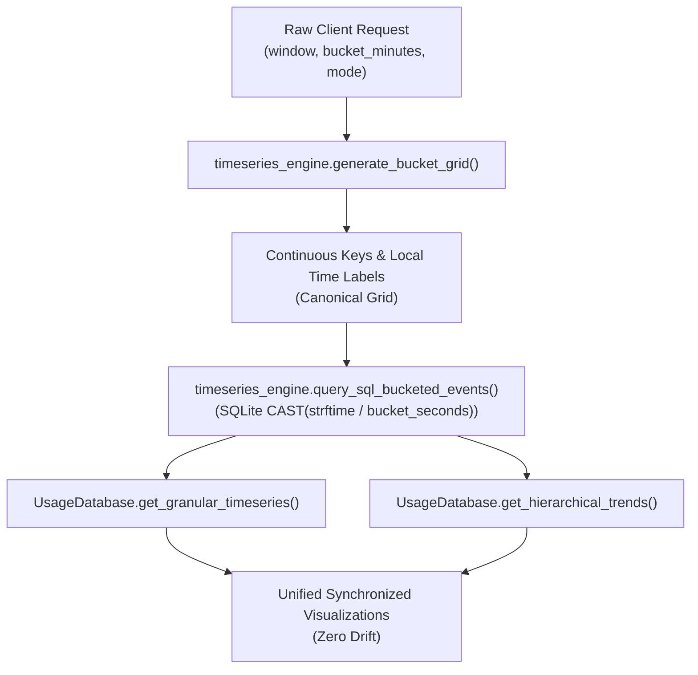

# Feature Recipe: AIUM-1006 - Unified SQL-Bucketed Time-Series Engine

## Overview
Implement a unified, high-performance, SQL-assisted time-series bucketing engine (`backend/storage/timeseries_engine.py`) for AI Usage Monitor.
Eliminates analytical drift between top-level dashboard velocity charts (`get_granular_timeseries`) and hierarchical breakdown trend curves (`get_hierarchical_trends`).

## Key Capabilities & Requirements
1. **Canonical Bucket Resolution (`resolve_bucket_seconds`)**:
   - Standardized sliding window parsing (`1h` through `1y`).
   - Valid bucket minute enforcement (`1m`, `5m`, `10m`, `15m`, `30m`, `60m`).
   - Dynamic scaling for multi-day and multi-month windows to cap total bin bins `<= 288`.
   - Returns structured `BucketResolution` integer subclass exposing `bucket_seconds`, `bucket_minutes`, `num_bins`, and `win_mins`.
2. **Workstation Local-Time Alignment (`align_timestamp_to_bucket`)**:
   - Preserves timezone context and floor-aligns unix epochs, ISO strings, or datetimes to exact bucket boundaries.
3. **Unified Bucket Grid Generation (`generate_bucket_grid`)**:
   - Emits canonical ISO 8601 keys (`%Y-%m-%dT%H:%M`) for accurate JavaScript client parsing.
   - Formats human-readable workstation local time labels (`%H:%M` for daily windows, `%b %d` for weekly/monthly windows).
   - Single canonical source of truth shared by both `get_granular_timeseries` and `get_hierarchical_trends`.
4. **SQL-Assisted Time-Bucket Aggregation (`query_sql_bucketed_events`)**:
   - Executes database-level grouping using SQLite integer division:
     `CAST(strftime('%s', recorded_at) AS INTEGER) / bucket_seconds`
   - High-speed server-side aggregation collapses thousands of interaction records per bucket while maintaining complete dimensional attribution (`model`, `user_name`, `team_name`, `token_id`, `client_ip`, `instance_id`, `source`, `is_proxied`).
5. **Mode Support (`apply_timeseries_mode`)**:
   - `interval_delta`: Discrete token bursts within each bucket interval, preserving idle zero baseline.
   - `cumulative`: Monotonically non-decreasing running total over the window envelope.
6. **Zero-Drift Mixin Architecture (`TimeSeriesEngineMixin`)**:
   - Mixed into `UsageDatabase`, ensuring zero duplication and unified telemetry semantics across all HTTP endpoints and desktop widgets.

## Architecture & Data Flow

## Verification & Testing
- Unit test suite: `tests/test_unified_timeseries_engine.py` (22 unit tests, 100% pass).
- Parity verification across `1m`, `5m`, `15m`, `60m` buckets between granular envelope and hierarchical series curves.
- Backwards compatibility: `tests/test_granular_timeseries_and_gemini_proxy.py`, `tests/test_hierarchical_trends_bucket_mode_localtime_alignment.py`.
