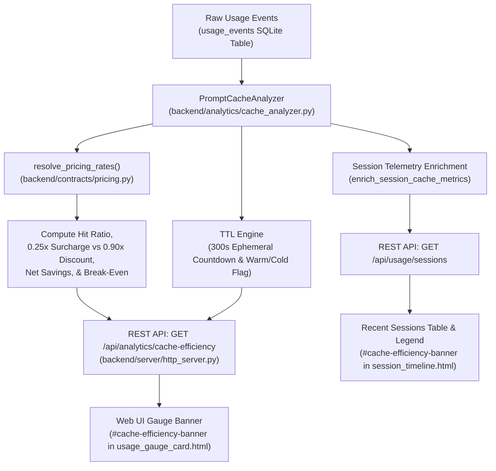

# Feature Recipe: AIUM-1009 - Prompt Cache Efficiency Analytics, TTL Keep-Alive Timer & Session Cache Columns

## 1. Overview & Business Rationale
Modern frontier AI models (particularly Anthropic Claude 3.5/3.7 Sonnet, Opus, Haiku) implement Prompt Caching to significantly lower inference costs and latency.
Anthropic ephemeral prompt caching operates on a **5-minute (300-second) Time-To-Live (TTL)** keep-alive window:
- **Cache Creation (Write)**: Incurs a 25% cost surcharge (1.25x base input token price).
- **Cache Read**: Grants a 90% discount (0.10x base input token price).
- **Net Break-Even**: Writing to cache is an investment; break-even requires subsequent cache reads before the 5-minute TTL expires.

Without granular cache observability, users and automated agents frequently suffer cache churn, where prompts are rewritten just after the 300s expiration, repeatedly incurring 1.25x write surcharges without reaping 90% read discounts.

Ticket AIUM-1009 introduces an end-to-end prompt cache analytics engine, real-time ephemeral TTL keep-alive countdown tracking, automated efficiency grading, enriched session telemetry, and UI banner metrics.

---

## 2. Mathematical & Analytical Specifications

### 2.1 Cache Hit Ratio Formula
$$\text{Hit Ratio (\%)} = \text{round}\left(\frac{\text{Total Cache Read Tokens}}{\text{Total Input Tokens} + \text{Total Cache Creation Tokens} + \text{Total Cache Read Tokens}} \times 100, 1\right)$$
- If the prompt denominator is 0, `cache_hit_ratio_pct` defaults to `0.0`.

### 2.2 Financial Economics (Net Savings & Surcharges)
Given base input token rate $R_{in}$ ($USD / token resolved via `resolve_pricing_rates`):
- **Cache Write Surcharge**:
  $$\text{Surcharge (USD)} = \text{Cache Creation Tokens} \times R_{in} \times 0.25$$
- **Gross Cache Read Savings**:
  $$\text{Gross Savings (USD)} = \text{Cache Read Tokens} \times R_{in} \times 0.90$$
- **Net Cache Savings**:
  $$\text{Net Savings (USD)} = \text{round}(\text{Gross Savings} - \text{Surcharge}, 4)$$
- **Break-Even Achieved**:
  $$\text{Break-Even} = \text{bool}(\text{Net Savings} \ge 0 \land \text{Total Cache Read Tokens} > 0)$$

### 2.3 Ephemeral TTL Keep-Alive Status (300s Ephemeral Window)
Inspects the most recent event with `cache_creation_tokens > 0` or `cache_read_tokens > 0`:
- $\Delta t = \text{max}(0.0, \text{now}_{utc} - \text{last\_touch}_{utc})$
- $\text{TTL Remaining (seconds)} = \text{max}(0, 300 - \Delta t)$
- $\text{is\_warm} = \text{bool}(\text{TTL Remaining} > 0)$
- $\text{ttl\_formatted} = \lfloor\frac{\text{TTL Remaining}}{60}\rfloor\text{m } (\text{TTL Remaining} \pmod{60})\text{s}$

### 2.4 Efficiency Grading Scale
- **A+ (Optimal)**: $\text{Hit Ratio} \ge 75.0\%$
- **A (High)**: $50.0\% \le \text{Hit Ratio} < 75.0\%$
- **B (Moderate)**: $25.0\% \le \text{Hit Ratio} < 50.0\%$
- **C (Low)**: $0.0\% < \text{Hit Ratio} < 25.0\%$
- **N/A**: $\text{Hit Ratio} = 0.0\%$

---

## 3. Architecture & Data Flow



---

## 4. REST API Endpoint

### `GET /api/analytics/cache-efficiency`
**Query Parameters**:
- `provider`: (Optional, default `"claude"`) Provider filter or `"all"`.
- `hours`: (Optional, default `24`) Time window in hours.

**Response Schema (`200 OK`)**:
```json
{
  "provider": "claude",
  "hours": 24,
  "total_input_tokens": 15000,
  "total_output_tokens": 4200,
  "total_cache_creation_tokens": 10000,
  "total_cache_read_tokens": 75000,
  "total_tokens": 104200,
  "cache_hit_ratio_pct": 75.0,
  "cache_write_surcharge_usd": 0.0075,
  "gross_cache_read_savings_usd": 0.2025,
  "net_cache_savings_usd": 0.1950,
  "break_even_achieved": true,
  "ttl_status": {
    "is_warm": true,
    "ttl_remaining_seconds": 240,
    "ttl_formatted": "4m 0s",
    "last_touch_utc": "2026-11-07T16:51:00+00:00"
  },
  "efficiency_grade": "A+",
  "event_count": 8
}
```

---

## 5. UI Components Integration

1. `frontend/components/usage_gauge_card.html`:
   - Contains `#cache-efficiency-banner` displaying cache hit ratio, ephemeral TTL countdown, and net monetary savings.
   - Preserves all 15 sliding window selectors, multi-scope controls, and zero double-accounting invariants.

2. `frontend/components/session_timeline.html`:
   - Contains `#cache-efficiency-banner` pill strip above the session table.
   - Dedicated table columns: `Cache Read`, `Cache Write`, `Net Savings`.
   - Explanatory metrics legend clarifying 0.10x cost, 1.25x surcharge, and 300s TTL.
   - Preserves all sorting icons and `width: 100%` full-width layout compliance.

---

## 6. Verification & Test Plan

Unit test suite: `tests/test_prompt_cache_efficiency_analytics.py`:
- [x] Zero denominator prompt token handling.
- [x] Accurate mathematical calculation of hit ratio across normal and edge cases (100% reads, 100% writes).
- [x] Accurate 0.25x write surcharge calculation using model pricing matrix ($3.00/M Sonnet, $15.00/M Opus, etc.).
- [x] Accurate 0.90x gross read discount calculation.
- [x] Net savings and break-even validation (positive, negative, and zero reads).
- [x] Anthropic 300-second ephemeral TTL countdown (active warm, expired cold, exact 300s boundary, no cache touch).
- [x] Efficiency grade boundaries (`A+`, `A`, `B`, `C`, `N/A`).
- [x] Session dictionary enrichment (`cache_hit_ratio_pct`, `net_cache_savings_usd`, `cache_badge_label`).
- [x] HTTP REST API `GET /api/analytics/cache-efficiency` execution and parameter validation.
- [x] Component DOM ID presence and styling verification.
