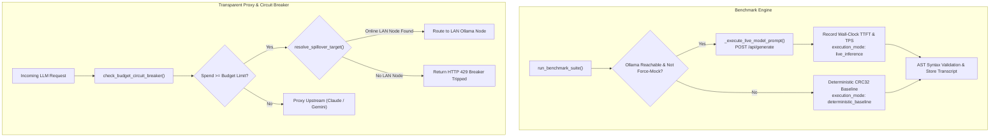

# Feature Recipe: AIUM-1011 - Live Ollama/Cloud Benchmark Execution, Transcript Inspection Modal & Budget Circuit Breakers

## 1. Overview
Enhance AI Usage Monitor's evaluation and proxy systems with live local model execution, deterministic fallback guarantees, evaluation transcript inspection, budget safety circuit breakers, and automated cloud-to-LAN failover spillover.

- **Live Ollama Inference**: Executes real model prompts against local Ollama runtime (`POST http://127.0.0.1:11434/api/generate`), capturing real wall-clock time-to-first-token (TTFT), tokens-per-second velocity, and generated code transcripts.
- **Deterministic Baseline Fallback**: Implements `zlib.crc32(model.encode('utf-8'))` hashing for simulated/baseline latency, guaranteeing 100% reproducible metrics across Python runtime restarts and avoiding Python's non-deterministic salted `hash()` behavior.
- **Transcript Inspection Modal**: Provides full prompt and response visibility (`id="benchmark-transcript-modal"`), model metadata, execution mode badge (`Live Inference` vs `Baseline`), and AST syntax diagnostics upon clicking evaluation records.
- **Budget Circuit Breakers**: Transparent proxy gates request execution against configured `proxy_hourly_budget_usd` and `proxy_session_budget_usd` settings, preventing runaway loops and unbudgeted cloud expenditures.
- **Cloud-to-LAN Spillover**: Intercepts requests when cloud provider quotas reach or exceed 85% utilization (or enter 429/ERROR states) and dynamically reroutes traffic to healthy, online LAN Ollama worker nodes.

---

## 2. ASD-STE100 Rules & Specifications

### Rule 1: Zero External Supply-Chain Dependencies
- Use strictly Python 3 standard library modules: `ast`, `json`, `time`, `zlib`, `urllib.request`, `urllib.error`, `datetime`.
- No third-party network libraries (e.g. `requests`, `httpx`).

### Rule 2: Deterministic Baseline Reproducibility
- In deterministic mode or when local runtimes are unreachable, latency and throughput calculations must not vary across process restarts.
- Use `zlib.crc32()` modulo operations instead of Python's randomized hash seed.

### Rule 3: Budget Gatekeeping & Failsafe Execution
- If hourly proxy spend reaches `proxy_hourly_budget_usd`, or session spend reaches `proxy_session_budget_usd`, immediately trip the breaker (`tripped: True`).
- Return structured status reporting spend and limit thresholds for inspection and alerting.

### Rule 4: Dynamic LAN Spillover Routing
- When `cloud_to_lan_spillover_enabled` is active and cloud session quota reaches 85% used (or error state), resolve online local worker node target from `managed_nodes`.

---

## 3. Architecture & Data Flow

---

## 4. Canonical Modules & Component Additions

1. **`backend/analytics/benchmark_engine.py`**:
   - `_execute_live_model_prompt(provider, model, prompt, timeout=8.0)`: Performs live HTTP inference against local Ollama daemon.
   - `run_benchmark_suite()`: Integrated live execution, `zlib.crc32` deterministic fallback, and transcript storage (`prompt_text`, `output_transcript`, `execution_mode`, `ast_diagnostics`).
2. **`backend/proxy/transparent_proxy.py`**:
   - `evaluate_budget_circuit_breaker(database, provider, session_id)` / `check_budget_circuit_breaker()`: Queries hourly and session spend from `usage_events` against `proxy_hourly_budget_usd` and `proxy_session_budget_usd`.
   - `evaluate_spillover_target(database, provider, nodes_provider)` / `resolve_spillover_target()`: Checks 5h quota saturation (>= 85%) and locates online LAN Ollama worker nodes.
   - `get_managed_nodes()`: Discovers registered compute nodes from SQLite storage.
   - `do_POST()`: Circuit breaker check intercepting upstream proxy dispatch when budgets trip.
3. **`frontend/components/benchmark_scorecard.html`**:
   - `id="benchmark-transcript-modal"`: Glassmorphic inspection dialog displaying prompt, output transcript, execution mode badge, and AST syntax diagnostics.

---

## 5. Verification & Test Suite

The test suite in `tests/test_live_benchmarks_and_circuit_breakers.py` validates:
- Deterministic CRC32 latency reproducibility across multiple instances and Python seeds.
- Live Ollama HTTP prompt execution, real TTFT capture, and transcript persistence via mocked `urlopen`.
- Unreachable Ollama runtime graceful fallback to deterministic baseline.
- `_force_deterministic_mock` flag honoring test constraints.
- Hourly budget circuit breaker tripping when spend exceeds threshold.
- Session budget circuit breaker tripping when session spend exceeds threshold.
- Unlimited budget behavior when limits are zero or unconfigured.
- Cloud-to-LAN spillover disabled setting adherence.
- Cloud-to-LAN spillover trigger when quota saturation >= 85%.
- Cloud-to-LAN spillover trigger on 429 / ERROR status snapshot.
- Selection of healthy online Ollama node with model and endpoint resolution.
- UI Modal element presence and structural schema compliance in `benchmark_scorecard.html`.
